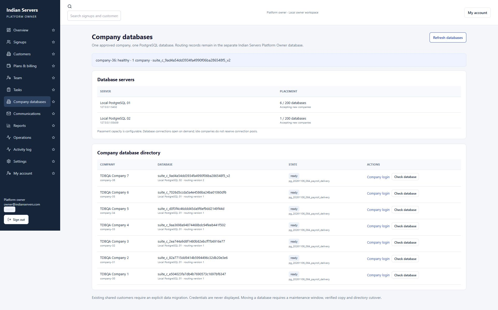
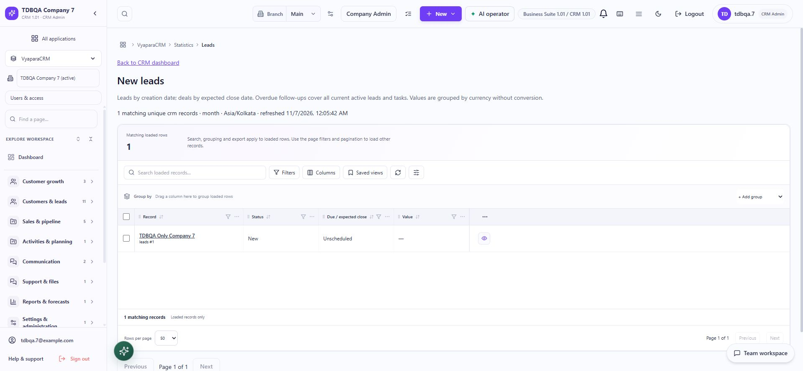
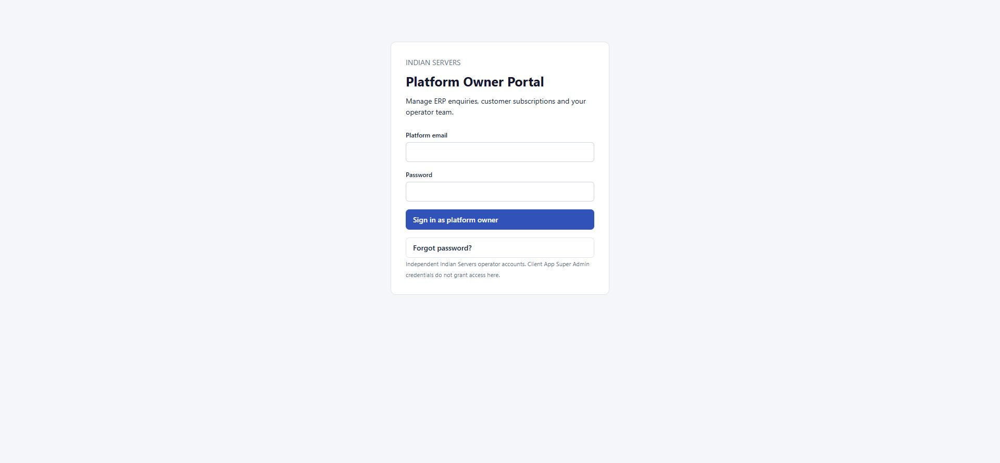

# Dedicated company PostgreSQL databases

Implemented locally for new approvals. The Indian Servers Platform Owner database remains separate; its `platform_database_servers` and `platform_tenant_databases` tables hold placement and routing metadata. Existing pre-approved shared customers require an explicit data migration and have not been moved.

## Approval and login

Approve a request from `/platform/signups` after saving its review checklist. Approval reserves a stable tenant UUID/workspace code, selects a registered server, creates a database and restricted role from a schema-only template, binds its identity, provisions the company/admin/subscription and prepares a local activation link. Individual signup workspaces also receive dedicated databases. No existing customer rows are copied from the shared database.

Invitations contain the workspace code. Company login accepts that code; access/refresh/MFA tokens carry the signed tenant UUID. The database directory at `/platform/databases` exposes health, schema/routing versions, placement and company login links without passwords.

Local provisioning currently executes synchronously in the approval handler. Independent directory reservations and durable business receipts support retry without duplicate companies/databases. Move privileged provisioning into a separately operated queue/process before high-volume production onboarding.

## Isolation

- The `suite_tenant_router` role can SELECT only the two directory tables. Reading owner signups with that role was denied.
- Runtime passwords are encrypted with an independent Fernet key. Preserve `TENANT_SECRET_KEY` with operational secrets; credentials and server provisioning URLs are never returned by the owner APIs.
- Verified tenant context is established before middleware/dependencies open business connections. A client workspace header cannot override a signed session. Unknown, mismatched or maintenance routes fail closed, with no fallback to another database.
- Each runtime role has no superuser, database creation, role creation, ownership or schema CREATE privileges. Other company and owner DB connections are denied.
- Every tenant session verifies the database name and immutable `suite_tenant_identity` row. A database CHECK restricts `companies` to its allocated company ID.
- Local user/session/record IDs may overlap. Browser cache identity, server record-sync scope and PMS realtime subscriptions include tenant identity. Global company IDs use a reserved high range so organization file prefixes remain distinct.
- Customer lifecycle bridges explicitly resolve their company's DB. Audit, API requests and company jobs use the same routing. Runtime credentials never become client-facing credentials.

## Scaling and maintenance

Server location is metadata independent of company identity. The engine cache is bounded (default64); NullPool reserves no idle connections per company. The sample placement capacity200 is a configurable limit, not measured production capacity. Production can use deliberately sized PgBouncer endpoints; PgBouncer was not installed here.

`TENANT_WORKER_SHARDS` and `TENANT_WORKER_SHARD` partition dedicated company jobs. Email, follow-up, Celery and company-aware Power Apps execution use tenant context; the Power Apps CLI accepts `--workspace`. Remote operations default off. Future remote operations require explicit configuration plus verified TLS; this work used two local PostgreSQL instances only.

Thousands-of-company load, HA, production connection budgets and backup/restore operations need capacity testing and operational configuration before production. Separate databases on one PostgreSQL server still share compute and storage resources.

Run these from backend using `venv/Scripts/python`:

- `scripts/setup_local_company_databases.py` — configure the first local server, schema-only template, directory role and ignored local secrets. Restart backend after initial configuration.
- `scripts/setup_local_company_server.py` — sample second local PostgreSQL instance on127.0.0.1:55439; data under `.local/company-postgres-02`.
- `scripts/manage_company_databases.py list`
- `scripts/manage_company_databases.py check --workspace company-36`
- `scripts/manage_company_databases.py upgrade --workspace company-36`
- `scripts/manage_company_databases.py upgrade --all`
- `scripts/manage_company_databases.py refresh-template --server local-01`
- `scripts/manage_company_databases.py move --workspace company-36 --server local-02`

Upgrade the canonical business schema first, refresh schema-only templates for future signups, and roll company upgrades through controlled maintenance batches. Old templates are retained when refreshed.

Moving a company marks it moving, prevents runtime connections, drains that company's sessions, dumps/restores into a new destination, verifies all public-table counts and runtime identity, atomically changes the directory and increments its routing version. Source connections are disabled and the source copy retained. A pre-cutover failure restores source routing and disables any newly created partial destination. After destination writes begin, rollback requires reconciling or reverse-migrating those writes; never simply point back to stale data.

## Verification and limits

- Seven disposable TDBQA companies were approved, activated and logged in against seven distinct PostgreSQL DBs.
- Final post-move integration run: **198passed,0failed**. Includes own-company CRUD/read, refresh, assignment/header tampering, owner API denial, concurrent requests and maintenance mode.
- Additional SQL/migration assertions: **68passed,0failed**, including all42cross-company connection attempts across actual server ports, seven owner-DB denials, one-company constraints and idempotent receipt retry.
- Regression suite: **88passed**. Includes signed routing, refresh, fail-closed behavior, bounded engines, secret redaction and realtime isolation with overlapping local IDs.
- Frontend local build passed.
- Browser: all seven Company Admins displayed only their own company and QA lead; all seven owner health checks showed exactly one company. Company sessions attempting owner database/signup pages were redirected to the separate owner login. Manual workspace override passed: an invitation URL for company-31 was overridden to company-36, which authenticated Company7 on the second server.
- Company7 moved from local PostgreSQL5432 to a separately initialized instance55439, routing version2. Login, its existing lead, health and a no-op Alembic upgrade passed after cutover. Source is retained with connections disabled.

QA records remain for inspection. Messages stayed local; no deployment, push, remote database operation, external email or payment occurred. No assertion of exhaustive module/load/failure testing is made.

Evidence: `outputs/company-databases-local.json`, `outputs/company-databases-sql-proof.json`, `outputs/company-databases-regression.xml`, and repeatable `backend/scripts/qa_company_databases_local.py`.

## QA company directory

- TDBQA Company 1: company-30 -> suite_c_e504023fa7db4b7690573c1697bf6347; server port 5432.
- TDBQA Company 2: company-31 -> suite_c_82a7715dd9414b5994496c32db20e3e6; server port 5432.
- TDBQA Company 3: company-32 -> suite_c_2ea744a9d8f1480b82ebcff7b6916e77; server port 5432.
- TDBQA Company 4: company-33 -> suite_c_9aa3698a94874468bdc94feeb441f502; server port 5432.
- TDBQA Company 5: company-34 -> suite_c_d0f3f4c46ddd45da9f6ef9dd2149f44d; server port 5432.
- TDBQA Company 6: company-35 -> suite_c_7026d5ccda5a4e4586ba24ba01060df6; server port 5432.
- TDBQA Company 7: company-36 -> suite_c_9ad4a54dd3934fa4990f06ba286548f5_v2; server port 55439, routing version2.

Development-server note: file-watch restarts caused transient Vite proxy connection resets during final browser login checks. Successful retries were verified after the backend was ready; no security bypass or production fallback was added.
