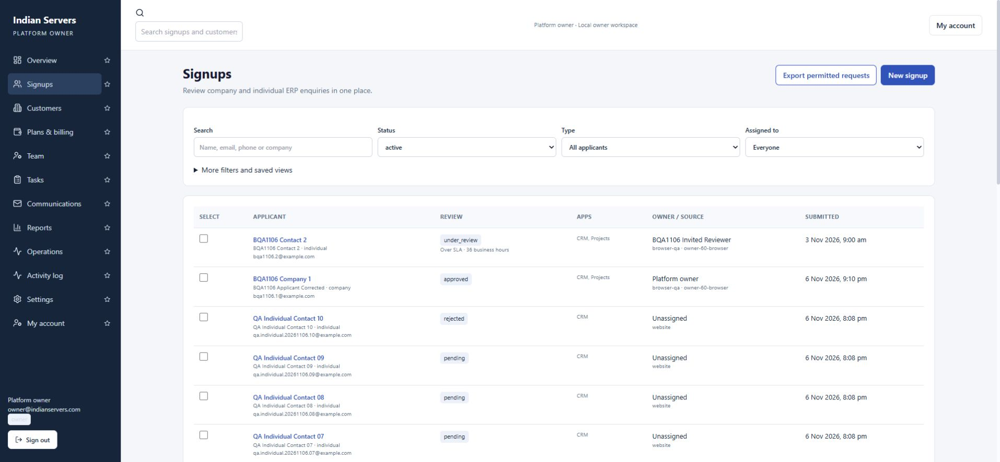
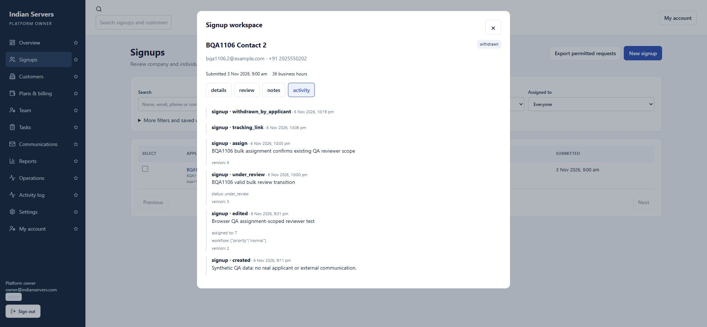

# Platform Owner local browser QA — 6 November 2026

All 60 feature workflows now have representative browser checks. These are not an exhaustive test of every input combination or failure mode; backend-only failure injection is identified below. The final applicant withdrawal was confirmed by the user and verified in both the public result and owner lifecycle/history.

Local frontend5191/backend1534, independent local PostgreSQL owner database. Disposable prefix BQA1106, signup IDs21–23/customer2. Time-based tests used guarded local fixtures to age SLA, session, trial, support and schedule dates; actions and resulting states were inspected through Chrome. No external messages or payments.

## Fixes

- Remount Tasks/Communications record workspaces to prevent stale outbox state. Browser recheck passed.
- Completed due-date tasks show Reopen. Browser recheck passed.
- Personal notifications restricted to recipient, including owner queries. Regression test and browser recheck passed.
- Support Operations defaults to permitted Support and hides unavailable controls. Browser recheck passed.
- Native purge confirm replaced by explicit in-page confirmation; hold denial and successful purge verified. Deleted detail closes immediately (final build passed).

## Feature evidence

1. PASS: independent owner login; business credentials rejected.
2. PASS: live overview, counts and customer lifecycle.
3. PASS: name/preferences saved and restored.
4. PASS: QA reviewer second device revoked; first retained.
5. PASS: aged QA support session redirected to login.
6. PASS after fix: recipient-specific inbox; mark read; owner no longer sees reviewer task notice.
7. PASS: global search returns permitted signup/customer.
8. PASS: user completed reviewer reset; new password login works and replay rejected.
9. PASS: favorite moved navigation and restored.
10. PASS: successful and failed login history displayed.
11. PASS: owner, reviewer, support, sales, billing and analyst browser logins; role navigation and assigned-only totals verified.
12. PASS: QA reviewer narrowed to signup.read.
13. PASS: staff access review saved; disabling QA analyst showed Disabled and invalidated its active browser session. Left disabled.
14. PASS: named invite activated by user, replay rejected.
15. PASS: platform activity log, actor/reason/export/change events; signup before/after history.
16. PASS: assigned-only reviewer sees only request22, foreign21 not found; Team denied.
17. PASS: reviewer export absent; owner export audited. CSV downloaded and checked locally.
18. PASS after fixes: task assignment, priority, date, complete/reopen; due-date completed item says Reopen.
19. PASS: consent requested/approved via private link and expired state verified.
20. PASS: one-day reports-only integration key created and revoked; scope behavior covered by backend tests.
21. PASS: complete workspace, consent, apps, history and progress.
22. PASS: company/individual created through browser with attribution.
23. PASS: pending contact/priority changes persisted with history.
24. PASS representative filters: search/type/source/module; exhaustive combinations not tested.
25. PASS: shared view saved, applied correct source/module/search filters, then archived from Tasks.
26. PASS: temporary matching phone detected request21; restored unique phone.
27. PASS: single and bulk assignment preview/commit saved QA reviewer assignment with reason.
28. PASS: mixed pending/approved preview blocked commit; valid one-record bulk under_review committed.
29. PASS: archive/restore preserved prior state.
30. PASS: archived aged QA23legal hold blocked purge; hold released, explicit in-page confirmation submitted; direct link then returned Signup request not found. Fixed stale detail form to close after successful purge.
31. PASS: pending, under review, awaiting applicant, approved, rejected, withdrawn, archived and restored states observed across synthetic records.
32. PASS: missing approval checklist rejected; completed checklist saved.
33. PASS: custom7day/3seat/500MiB trial provisioned.
34. PASS: reason template created and selected.
35. PASS: private correction submitted once, original audited, replay rejected.
36. PASS: company/admin/apps/invitation progress completed.
37. PASS representative recovery: rejected incomplete-checklist attempt marked recovered after successful provisioning; cross-database failure injection covered by backend test.
38. PASS: revoke/replacement and user activation; accepted invitation state observed in reports.
39. PASS: aged pending request shows36business hours, overdue operation and targeted notification.
40. PASS: private status exposed only QA22; user confirmed withdrawal; public page showed response saved. Owner Withdrawn filter showed QA22 and activity recorded withdrawn_by_applicant at 10:19 pm IST.
41. PASS: directory primary admin/configuration/aggregate usage.
42. PASS: both email-holder confirmation links approved; new company-scoped admin activated by user.
43. PASS: expired subscription yields0apps in actual QA client; local Trial expired outbox record.
44. PASS: five-day extension and mirror date observed.
45. PASS: paid conversion reuses customer; offline receipt INR1999.50.
46. PASS: future change scheduled; aged fixture processed; scheduled_plan_applied history verified.
47. PASS: allowances saved2seats/600MiB/CRM; restored plan10seats/2048MiB/2apps.
48. PASS: suspend and reactivate with reason and history.
49. PASS: cancelled/offboarded disposable tenant, retention4Feb2027, preservation notice; customer2configuration JSON downloaded.
50. PASS: snapshot created and restored original trial date.
51. PASS: signup company/individual/state cohort counts.
52. PASS: acquisition days, preset/custom date report; previous-period metric displayed.
53. PASS: after synthetic rejection reports showed66.7%approved/33.3%rejected among3decided; undecided excluded.
54. PASS: median/p90 business-hour values displayed.
55. PASS: distinct22submitted/2approved/2invited/1activated/1paid at observed cohort.
56. PASS: multi-app CRM22/Projects2 at observed cohort.
57. PASS: website/browser-qa and campaign grouping.
58. PASS: seats/storage/activation aggregates shown without ERP payloads.
59. PASS: INR1999.50receipt, cancellation count and0currentpaid after QA offboarding.
60. PASS: health counters, due checks, scheduled report snapshot and downloaded report JSON verified.

## Identity boundary

Business global superuser browser: owner pages signups/customers/team/settings/reports/operations/audit/profile redirect to owner login; business credentials rejected at owner login. Actual company-scoped QA admin (bqa1106.next-admin@example.com) logged into its sole company and direct owner signups/customers/reports and legacy admin/signup-requests redirected to owner login. Supplementary authenticated business superuser API checks returned401for owner me/signups/customers/staff/reports/events/settings/outbox and legacy signup list/review.

## Automated validation

Latest focused run:65passed (test_platform_portal.py, test_public_signup.py, test_company_security_boundary.py), including new personal-notification regression. Final npm run build:local passed.

## Local QA residue

Disposable customer2is offboarded; ERP records preserved. Request22withdrawn by applicant; request23purged. Original synthetic QA Individual Contact10rejected for denominator test. QA analyst disabled. QA integration key revoked. User completed QA staff/client activation and reviewer reset; owner password unchanged. QA staff accounts remain for remaining role checks.

Actual company-admin API supplement: authenticated QA client is_superuser=False; owner me/signups/customers/staff/reports/events/settings/outbox and legacy signup list all returned401. Downloaded CSV has22records and excludes the purged QA23email. Report JSON and configuration JSON files were inspected locally.

Final browser verification: 6 November 2026, approximately 10:23 pm IST. The user completed the native withdrawal confirmation. Owner workspace shows withdrawn and the applicant audit event.

